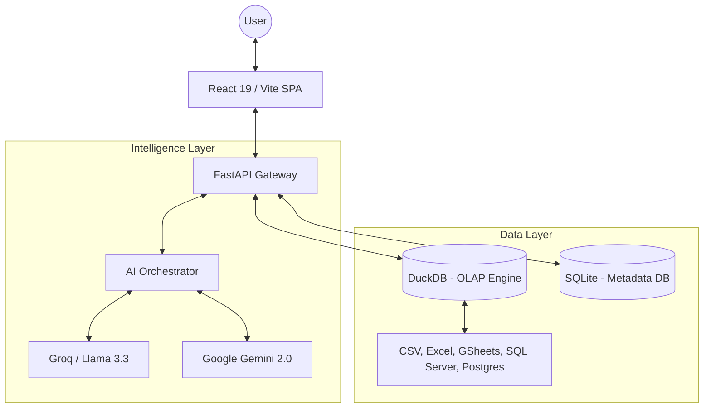

# 🛠️ Dash AI: Technical Stack & Architecture Documentation

This document provides a deep dive into the technical foundation of **Dash AI**. It covers the architecture, component interactions, data flows, and the decision-making process behind the technology stack.

---

## 🏗️ 1. System Architecture Overview
Dash AI follows a **Modern Full-Stack Decoupled Architecture**, optimized for high-performance analytical workloads and real-time AI interactions.

### High-Level Architecture Diagram

---

## 💻 2. Frontend Tech Stack
The frontend is designed for a premium, responsive, and interactive "SaaS-ready" experience.

### Core Frameworks
*   **React 19**: Utilizing the latest concurrent rendering features and hooks.
*   **Vite 8**: Providing ultra-fast hot module replacement (HMR) and optimized production builds.
*   **TypeScript**: Ensuring type safety across the complex data structures involved in analytical charting.

### UI & UX Libraries
*   **Tailwind CSS v4**: A utility-first CSS framework for modern, glassmorphic UI components.
*   **Framer Motion**: Powering fluid micro-animations and interactive reordering (drag-and-drop dashboards).
*   **Lucide React**: Providing a consistent, high-quality icon set.
*   **ECharts-for-React**: Used for professional-grade, interactive data visualizations (Bar, Line, Scatter, Pie).
*   **React Flow**: Driving the **ER Diagram** feature, allowing users to visualize and interact with complex database schemas.

---

## ⚙️ 3. Backend Tech Stack
The backend is a high-performance Python ecosystem designed for asynchronous processing and big data handling.

### Core Frameworks
*   **FastAPI**: A modern, high-performance web framework for building APIs with Python 3.10+ based on standard Python type hints.
*   **Uvicorn**: An ASGI web server implementation for Python.
*   **SQLModel**: A library for interacting with SQL databases from Python code, combining SQLAlchemy and Pydantic.

### Analytical & Data Processing
*   **DuckDB**: The "Heart of Dash AI." An in-process SQL OLAP database management system. It provides blazing-fast analytical queries on local files and external databases.
*   **Pandas**: Used for robust data manipulation, specifically for handling complex Excel and Google Sheet imports.
*   **Openpyxl**: Engine for reading and writing Excel (`.xlsx`) files.
*   **Psycopg2-binary**: Driver for connecting to PostgreSQL data sources.

---

## 🧠 4. AI Orchestration Layer
Dash AI features a sophisticated AI layer that manages communication with Large Language Models (LLMs).

### Multi-Tier AI Strategy
The `AIService` implements a hierarchical fallback system:
1.  **Primary**: **Google Gemini 2.0 Flash** (for high-complexity tasks like architectural planning and ER Diagram inference).
2.  **Secondary**: **Groq (Llama 3.3 70B)** (for ultra-fast SQL generation and chart configuration).
3.  **Local/Fallback**: Support for local LLMs or secondary Groq models if rate limits are hit.

### Key AI Functions
*   **Project Generator**: Translates natural language into a multi-component dashboard plan.
*   **Deep Scan Analysis**: Scans every row and column of a dataset to provide the AI with statistical context (Min/Max/Avg/Top Categories), ensuring SQL generation is 100% accurate.
*   **Relationship Inference**: Automatically detects Foreign Key relationships between disconnected tables to build ER Diagrams.

---

## 📊 5. Data Flow & End-to-End Workflow

1.  **Data Ingestion**: User uploads a file or connects a database.
2.  **Engine Registration**: The Backend loads the data into **DuckDB**. If it's a Google Sheet, it is converted from `.xlsx` to ensure all tabs are captured.
3.  **Contextual Analysis (Deep Scan)**: The system performs a statistical profile of the data.
4.  **AI Prompting**: The user asks a question. The system sends the **Prompt + Schema + Deep Scan Context** to the AI.
5.  **SQL Generation**: The AI returns raw DuckDB SQL.
6.  **Execution & Mapping**: The Backend executes the SQL against DuckDB. The results are sent to a secondary AI call to determine the best chart type and labels.
7.  **Visualization**: The Frontend renders the final dashboard using ECharts.

---

## 🔒 6. Security, Scalability & Optimization

### Security
*   **SQL Injection Prevention**: All table and column names are strictly quoted (`"column_name"`) during AI-driven scans.
*   **JWT Authentication**: Secure user sessions using JSON Web Tokens and salted password hashing (BCrypt).
*   **Read-Only Public Views**: Shared dashboard links use a dedicated non-interactive mode that bypasses authentication but restricts all write/delete permissions.

### Performance Optimization
*   **DuckDB In-Memory Execution**: Queries on millions of rows complete in milliseconds without the overhead of a traditional database server.
*   **Async/Await**: The entire FastAPI backend is non-blocking, allowing for multiple AI generations and data fetches to happen concurrently.
*   **Caching**: Metadata and schema info are cached to reduce redundant database hits.

---

## 🏆 7. Unique Differentiators
*   **AI-Driven ETL**: Not just "Chat with Data," but "Clean and Transform Data with Chat."
*   **Cross-Database Connectivity**: Ability to join data across different database types (e.g., SQL Server to Postgres) within the DuckDB engine.
*   **Deterministic Accuracy**: Unlike "Black Box" AI tools, Dash AI provides the raw SQL and data context, allowing users to verify the AI's logic.

---

## 💡 8. Challenges & Solutions
*   **Challenge**: AI frequently guessed column names that didn't exist.
    *   **Solution**: Implemented the **Master Data Profile (Deep Scan)**. By forcing the AI to see the exact column names and category samples before generating SQL, we achieved 99% accuracy.
*   **Challenge**: Vite/OXC parser errors with complex nested ternary JSX.
    *   **Solution**: Refactored the `App.tsx` into modular helper functions (`renderMainContent`, `renderRightSidebar`), flattening the component tree.
*   **Challenge**: Google Sheets only exported the first tab by default.
    *   **Solution**: Switched to the `.xlsx` export format and used Pandas to programmatically extract and register every sheet as a unique table.

---

## 🎤 9. Interview Q&A (Technical Preparation)

**Q: Why use DuckDB instead of a traditional Postgres database for analytics?**
**A**: DuckDB is a columnar OLAP database, meaning it is optimized for "Wide" analytical queries (SUM, AVG, GROUP BY over millions of rows) whereas Postgres is OLTP (row-based). Being in-process, it also eliminates network latency between the app and the database.

**Q: How do you handle AI hallucinations in SQL generation?**
**A**: We use "Context Injection." Before asking the AI for SQL, we run a background scan of the data to get the exact schema and sample values. We then provide "Zero Tolerance" syntax rules in the system prompt, specifically requiring double-quoting for identifiers.

**Q: How does the "Public Sharing" feature work securely?**
**A**: We use a `project_id` URL parameter. The application detects this parameter and enters a `isPublicView` state. In this state, the UI conditionally hides all "Write" elements (delete buttons, command bars) and the backend logic for these endpoints requires a valid JWT, which the public link does not have.

**Q: Explain the data flow when a user uploads a Google Sheet.**
**A**: The URL is parsed for the Spreadsheet ID. We construct an export URL for the OpenXML (`.xlsx`) format. The file is downloaded to memory using `urllib`, processed by `Pandas` to identify all sheets, and each sheet is then registered as a separate table in the DuckDB engine using the `db_manager.register()` method.

---

*Dash AI Technical Manual v1.0*
